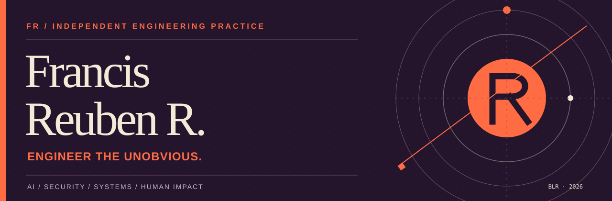

<p align="center">
  
</p>

<p align="center">
  <a href="https://github.com/francisreubenr-rvu?tab=repositories">Explore the work</a> &nbsp;·&nbsp;
  <a href="https://www.linkedin.com/in/francis-reuben-r">LinkedIn</a> &nbsp;·&nbsp;
  <a href="mailto:francisreubenrbtech25@rvu.edu.in">Email</a>
</p>

---

### Hello, I'm Francis.

I'm a Computer Science Engineering student specializing in Data Science at **RV University, Bengaluru**. I work across applied AI, security, computer vision, and full-stack engineering.

I like building things that move beyond the demo: systems with discernible architecture, explicit constraints, and actual users in mind. The interesting part isn't just making something work. It's making its behavior understandable, dependable, and useful.

**Currently exploring:** local-first intelligence · trustworthy AI-assisted workflows · accessible interfaces · security engineering.

### Selected work

| Project | What it investigates |
| :--- | :--- |
| **[EMET](https://github.com/francisreubenr-rvu/Emet)** | **Security / threat intelligence.** Orchestrates vulnerability scanners, normalizes their findings, adds NVD, EPSS and CISA KEV context, and keeps provenance attached to the result. |
| **[SignBridge](https://github.com/francisreubenr-rvu/SignBridge)** | **Computer vision / accessibility.** Translates supported ASL signs through hand-landmark classification, temporal stabilization, and a real-time interface, with hardware integration. |
| **[suzune](https://github.com/francisreubenr-rvu/suzune)** | **Local-first AI / systems.** A macOS voice dictation tool that runs speech recognition and text cleanup on-device, without a cloud transcription pipeline. |
| **[The Verdict Room](https://github.com/francisreubenr-rvu/verdict-room)** | **Evidence-driven AI.** A purchasing research workflow designed to turn scattered reviews and search results into an attributable recommendation. |
| **[BridgeNeed](https://github.com/francisreubenr-rvu/BridgeNeed)** | **Civic technology.** A platform concept connecting needs reporting, NGO coordination, and public accountability. |
| **[strings-guitar](https://github.com/francisreubenr-rvu/strings-guitar)** | **Human-computer interaction.** An experimental webcam-based guitar coach using hand landmarks for chord recognition. |

> These projects span different stages of maturity. See each repository for implementation details, setup instructions, and current limitations.

### Engineering interests

`01` **Intelligent systems** — ML pipelines, computer vision, retrieval, and grounded model outputs.  
`02` **Secure systems** — vulnerability analysis, traceability, privacy-aware design, and explicit failure modes.  
`03` **Product engineering** — TypeScript, React/Next.js, Python, APIs, and usable interfaces.  
`04` **Local-first computing** — on-device inference and software that minimizes unnecessary data movement.

### Principles

```text
BE CURIOUS           Ask better questions.
BUILD DELIBERATELY   Understand the constraints.
SHOW THE WORK        Make evidence inspectable.
SHIP RESPONSIBLY     Name the limitations.
```

### Elsewhere

Based in **Bengaluru, India**. Open to thoughtful technical collaboration and conversations about building useful systems.

**[Repositories](https://github.com/francisreubenr-rvu?tab=repositories)** · **[LinkedIn](https://www.linkedin.com/in/francis-reuben-r)** · **[Email](mailto:francisreubenrbtech25@rvu.edu.in)**

<sub>Built to be read, not scrolled past. Last editorial refresh: October 2026.</sub>
