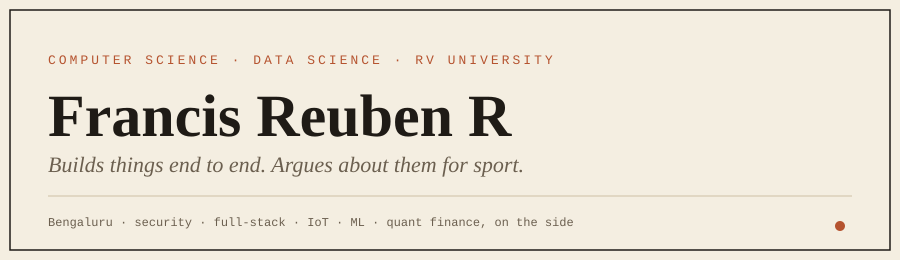

B.Tech CSE (Data Science) at RV University, Bengaluru. I start from a problem someone actually has, ship a rough version early, and rebuild it until it holds. Most of what is below was built to solve something specific, not to fill a repository list.

| | |
|---|---|
| **Studying** | Algorithms, computer networks, data science and IoT, third semester |
| **Building** | IoT sensing hardware on an ESP32, and web products that need a real user to survive |
| **Reading up on** | Quantitative finance, on a self-set 180-day roadmap |
| **Looking for** | Internships in software, security or ML. Active search, nothing signed |

| Project | What it does | Built with |
|---|---|---|
| [**Emet**](https://github.com/francisreubenr-rvu/Emet) | RAG-based vulnerability intelligence platform. The v2.0 build won CyberShield 2026. | Python |
| [**verdict-room**](https://github.com/francisreubenr-rvu/verdict-room) ([live](https://verdict-room.vercel.app)) | Purchase research assistant. Reads reviews, flags who got paid, gives a sourced verdict. | Next.js, Prisma, Groq |
| [**suzune**](https://github.com/francisreubenr-rvu/suzune) | Local-first voice dictation for macOS. Press a key, speak, get clean text in any app. | Tauri, Rust |
| [**quorum**](https://github.com/francisreubenr-rvu/quorum) | Multi-agent AI advisory boardroom. | TypeScript |
| [**coders-zone**](https://github.com/francisreubenr-rvu/coders-zone) | Attempt-first AI coding mentor for C, C++, Java and Python coursework. | TypeScript |
| [**strings-guitar**](https://github.com/francisreubenr-rvu/strings-guitar) | Webcam guitar coach with real-time hand tracking. | Next.js, MediaPipe |
| [**marque**](https://github.com/francisreubenr-rvu/marque) ([live](https://francisreubenr-rvu.github.io/marque/)) | SGPA calculator. The most finished thing here. | React, Vite |
| [**stonks**](https://github.com/francisreubenr-rvu/stonks) | Indian stock and mutual fund screener, NSE and BSE. | TypeScript, Cloudflare Worker |

Full list on the [repositories tab](https://github.com/francisreubenr-rvu?tab=repositories). Some of it is coursework and some of it is unfinished, and the commit dates will tell you which.

| Arena | Result |
|---|---|
| **Security hackathon** | CyberShield 2026 winner with Emet v2.0, built with Niharika KP, Gopreet Shaharsh and Aryan Dubey |
| **National hackathon** | Smart India Hackathon 2026 entry, ISRO problem statement SIH26171, six-person RVU team |
| **Debate** | Two-time State KISA Debate Champion |
| **Model UN** | Three-time Best MUNner |

The debate habit is the reason my READMEs argue a position and my pull requests come with reasons.

| Layer | Daily drivers |
|---|---|
| **Languages** | Python, C, TypeScript, JavaScript, SQL, Rust |
| **Web** | React, Next.js, FastAPI, Supabase, Prisma |
| **Ship** | Git, Vercel, Railway, Cloudflare Workers, OpenRouter |
| **Hardware** | ESP32 sensor nodes |

[LinkedIn](https://www.linkedin.com/in/francisreubenr) · [GitHub](https://github.com/francisreubenr-rvu)

If you have an internship that needs someone who ships and can defend the design afterwards, message me on LinkedIn.
